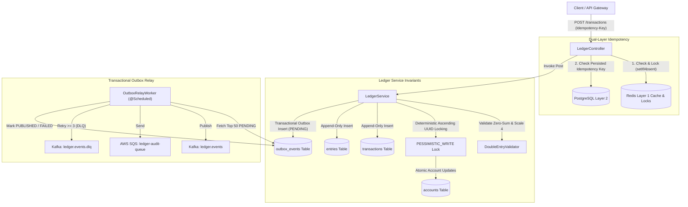

# Production-Grade Distributed Financial Ledger Engine

A high-performance, fault-tolerant, double-entry financial ledger service built with **Java 21**, **Spring Boot 3.3.4**, **PostgreSQL**, **Redis**, **Apache Kafka**, and **AWS SQS**.

---

## 1. System Architecture



---

## 2. Core Domain Invariants & Guarantees

### 1. Double-Entry Zero-Sum Rule
Every transaction requires at least 2 entries (`DEBIT` or `CREDIT`).
The sum of `DEBIT` amounts must strictly equal the sum of `CREDIT` amounts:
$$\sum \text{Debits} - \sum \text{Credits} = 0$$
If unbalanced or if amounts are non-positive, `UnbalancedTransactionException` (HTTP 422) is thrown before any database access occurs.

### 2. Strict Financial Precision
- Floating-point representations (`float`, `double`) are strictly prohibited across the entire codebase.
- All calculations utilize `java.math.BigDecimal` fixed to scale `4` with `RoundingMode.HALF_EVEN` (Banker's Rounding).
- All accounts and entries in a transaction must match the transaction's ISO-4217 currency code. Violations trigger `CurrencyMismatchException` (HTTP 422).

### 3. Append-Only Ledger Immutability
- The `transactions` and `entries` tables are strictly append-only (INSERT operations only; updates or deletes are forbidden).
- Account balances are updated atomically within the same `@Transactional` database boundary.

### 4. Deadlock-Free Deterministic Locking
When a transaction touches multiple accounts:
1. Extract distinct Account UUIDs.
2. Sort UUIDs deterministically in ascending alphanumeric order:
   ```java
   List<UUID> distinctSortedAccountIds = request.entries().stream()
       .map(EntryItemRequest::accountId)
       .distinct()
       .sorted(Comparator.comparing(UUID::toString))
       .toList();
   ```
3. Acquire pessimistic write locks (`@Lock(LockModeType.PESSIMISTIC_WRITE)`) in that exact sequential order via:
   ```sql
   SELECT a FROM Account a WHERE a.id = :id FOR UPDATE
   ```
4. Balance convention:
   - `CREDIT` increases account balance: `balance = balance.add(amount)`
   - `DEBIT` decreases account balance: `balance = balance.subtract(amount)`
5. Overdraft rule:
   - If `!account.isAllowNegative()` and new balance $< 0$, throw `InsufficientFundsException` (HTTP 422).

### 5. Dual-Layer Idempotency
- **Layer 1 (Redis):** Uses `StringRedisTemplate.opsForValue().setIfAbsent("idemp:" + key, "PROCESSING", 24h)` to block concurrent in-flight requests. Upon successful transaction commitment, serializes and caches the `TransactionResponse`.
- **Layer 2 (PostgreSQL):** Queries `LedgerTransactionRepository.findByIdempotencyKey(key)`. If previously committed, returns existing `TransactionResponse` with HTTP `200 OK`. New transactions return HTTP `201 Created`.

### 6. Transactional Outbox Pattern + Kafka & AWS SQS
- An `OutboxEvent` entity (`status = PENDING`, serialized JSON payload) is inserted into the PostgreSQL `outbox_events` table inside the exact same `@Transactional` boundary as the transaction and entries.
- `OutboxRelayWorker` polls pending events on a fixed schedule, delivers messages to Kafka (`ledger.events`) and AWS SQS (`ledger-audit-queue`), and marks events as `PUBLISHED`.
- On persistent failure (after 3 retries), events are routed to Dead-Letter Queue (`ledger.events.dlq`) and marked `FAILED`.

---

## 3. Database Schema

Schema migrations are managed automatically via Flyway (`V1__init_ledger_schema.sql`).

```sql
CREATE TABLE accounts (
    id UUID PRIMARY KEY,
    currency VARCHAR(3) NOT NULL,
    balance NUMERIC(19, 4) NOT NULL DEFAULT 0.0000,
    allow_negative BOOLEAN NOT NULL DEFAULT FALSE,
    created_at TIMESTAMP WITH TIME ZONE NOT NULL DEFAULT CURRENT_TIMESTAMP,
    updated_at TIMESTAMP WITH TIME ZONE NOT NULL DEFAULT CURRENT_TIMESTAMP,
    version BIGINT NOT NULL DEFAULT 0
);

CREATE TABLE transactions (
    id UUID PRIMARY KEY,
    idempotency_key VARCHAR(255) NOT NULL UNIQUE,
    currency VARCHAR(3) NOT NULL,
    description VARCHAR(500),
    created_at TIMESTAMP WITH TIME ZONE NOT NULL DEFAULT CURRENT_TIMESTAMP
);

CREATE TABLE entries (
    id UUID PRIMARY KEY,
    transaction_id UUID NOT NULL REFERENCES transactions(id),
    account_id UUID NOT NULL REFERENCES accounts(id),
    type VARCHAR(10) NOT NULL,
    amount NUMERIC(19, 4) NOT NULL,
    created_at TIMESTAMP WITH TIME ZONE NOT NULL DEFAULT CURRENT_TIMESTAMP
);

CREATE TABLE outbox_events (
    id UUID PRIMARY KEY,
    aggregate_type VARCHAR(100) NOT NULL,
    aggregate_id VARCHAR(255) NOT NULL,
    event_type VARCHAR(100) NOT NULL,
    payload TEXT NOT NULL,
    status VARCHAR(20) NOT NULL,
    retry_count INT NOT NULL DEFAULT 0,
    created_at TIMESTAMP WITH TIME ZONE NOT NULL DEFAULT CURRENT_TIMESTAMP,
    updated_at TIMESTAMP WITH TIME ZONE NOT NULL DEFAULT CURRENT_TIMESTAMP
);
```

---

## 4. REST API Specification

### 1. Create Account
`POST /api/v1/accounts`

**Request:**
```json
{
  "currency": "USD",
  "initialBalance": 1000.0000,
  "allowNegative": false
}
```

**Response (201 Created):**
```json
{
  "id": "9b1deb4d-3b7d-4bad-9bdd-2b0d7b3dcb6d",
  "currency": "USD",
  "balance": 1000.0000,
  "allowNegative": false,
  "createdAt": "2026-10-16T12:00:00Z",
  "updatedAt": "2026-10-16T12:00:00Z"
}
```

---

### 2. Get Account
`GET /api/v1/accounts/{id}`

**Response (200 OK):**
```json
{
  "id": "9b1deb4d-3b7d-4bad-9bdd-2b0d7b3dcb6d",
  "currency": "USD",
  "balance": 1000.0000,
  "allowNegative": false,
  "createdAt": "2026-10-16T12:00:00Z",
  "updatedAt": "2026-10-16T12:00:00Z"
}
```

---

### 3. Post Transaction
`POST /api/v1/ledger/transactions`

**Headers:**
- `Content-Type: application/json`
- `Idempotency-Key: e8a05c4b-b23d-4c3e-86d7-39e76fa3528b`

**Request Body:**
```json
{
  "currency": "USD",
  "description": "Cross-account fund transfer",
  "entries": [
    {
      "accountId": "9b1deb4d-3b7d-4bad-9bdd-2b0d7b3dcb6d",
      "type": "DEBIT",
      "amount": 250.0000,
      "currency": "USD"
    },
    {
      "accountId": "1c2e3f4a-5b6c-7d8e-9f0a-1b2c3d4e5f6a",
      "type": "CREDIT",
      "amount": 250.0000,
      "currency": "USD"
    }
  ]
}
```

**Response (201 Created on first call, 200 OK on idempotent retry):**
```json
{
  "id": "f47ac10b-58cc-4372-a567-0e02b2c3d479",
  "idempotencyKey": "e8a05c4b-b23d-4c3e-86d7-39e76fa3528b",
  "currency": "USD",
  "description": "Cross-account fund transfer",
  "entries": [
    {
      "id": "018f2d5a-939e-7164-89ec-9e227ea198bf",
      "accountId": "9b1deb4d-3b7d-4bad-9bdd-2b0d7b3dcb6d",
      "type": "DEBIT",
      "amount": 250.0000,
      "createdAt": "2026-10-16T12:00:05Z"
    },
    {
      "id": "018f2d5a-939e-7164-89ec-9e227ea198c0",
      "accountId": "1c2e3f4a-5b6c-7d8e-9f0a-1b2c3d4e5f6a",
      "type": "CREDIT",
      "amount": 250.0000,
      "createdAt": "2026-10-16T12:00:05Z"
    }
  ],
  "createdAt": "2026-10-16T12:00:05Z"
}
```

---

## 5. Local Setup and Execution

### Running Tests
Execute the complete test suite including unit tests and Spring Boot integration tests:
```bash
mvn clean test
```

### Running with Docker Compose
Start the full infrastructure stack (PostgreSQL, Redis, Kafka, LocalStack SQS, and Ledger Service):
```bash
docker compose up -d --build
```

Verify service health:
```bash
docker compose ps
```
